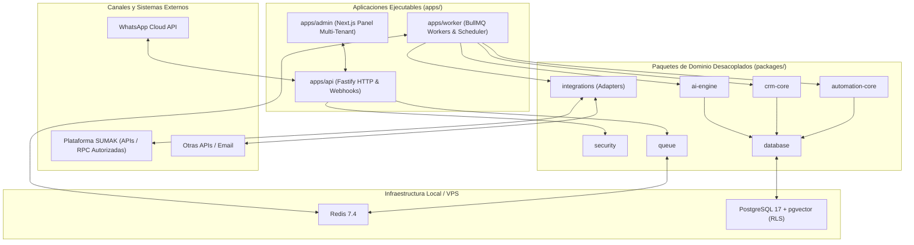
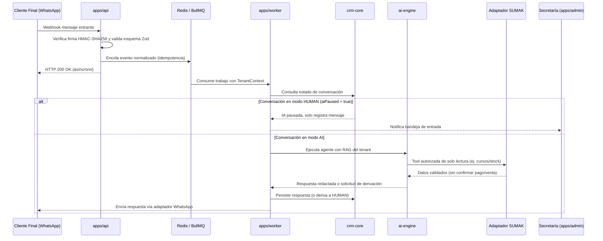

# Visión General del Sistema — RSD Sync

## 1. Diagrama de Componentes

---

## 2. Flujo de Atención Inteligente e Intervención Humana

---

## 3. Regla de Dependencias

Todas las dependencias entre paquetes fluyen hacia abajo hacia `@rsd-sync/contracts` y `@rsd-sync/shared`. Los paquetes núcleo (`automation-core`, `ai-engine`, `crm-core`, `security`, `database`, `queue`) nunca dependen de `@rsd-sync/integrations` ni de lógica de un cliente concreto.
