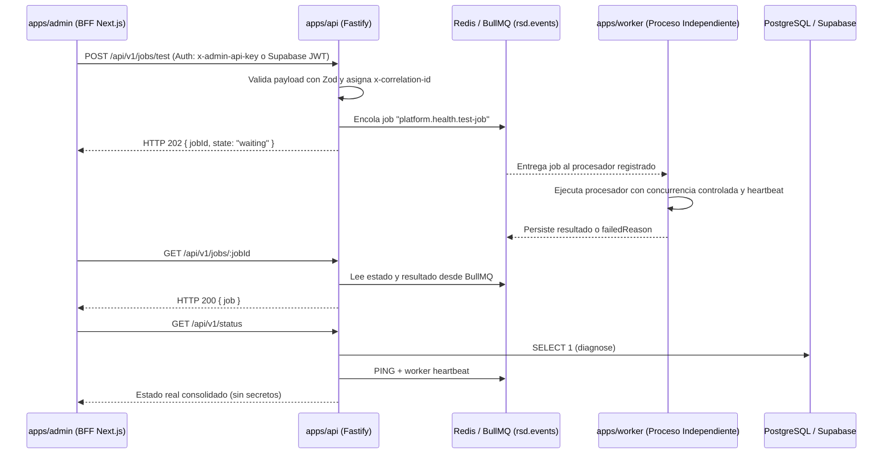

# Fase 1 — Infraestructura Operativa, Supabase y Primer Panel Web

Este documento describe la arquitectura implementada en la **Fase 1** de **RSD Sync**.

---

## 1. Flujo Operativo Implementado (API <-> Redis/BullMQ <-> Worker)

---

## 2. Endpoints de `apps/api`

| Método y Ruta | Autenticación | Propósito |
| --- | --- | --- |
| `GET /health` | Pública | Sonda simple de salud del proceso |
| `GET /health/live` | Pública | Liveness probe del proceso Fastify |
| `GET /health/ready` | Pública | Readiness probe (verifica Redis + PostgreSQL; devuelve `503` si falta dependencia) |
| `GET /api/v1/status` | Protegida (`Bearer` o `x-admin-api-key`) | Diagnóstico consolidado de API, Worker, Redis, Base de datos y Supabase |
| `POST /api/v1/jobs/test` | Protegida | Encola un trabajo de prueba validado con Zod en BullMQ |
| `GET /api/v1/jobs` | Protegida | Lista los últimos trabajos de prueba en BullMQ |
| `GET /api/v1/jobs/:jobId` | Protegida | Consulta estado, intentos, resultado o error de un trabajo específico |

---

## 3. PostgreSQL Local vs Supabase Cloud de RSD Sync

- **PostgreSQL Local (Docker)**: `127.0.0.1:54332` (`rsd-sync-postgres`), totalmente aislado del contenedor local de SUMAK (`54322`).
- **Supabase Cloud de RSD Sync**: Se configura mediante `RSD_DATABASE_URL`, `RSD_DATABASE_DIRECT_URL`, `SUPABASE_URL`, `SUPABASE_ANON_KEY` y `SUPABASE_SERVICE_ROLE_KEY` (solo backend).
- **Resolución (`resolveEffectiveDatabaseConnection`)**:
  - `DATABASE_TARGET=local` fuerza el uso de `DATABASE_URL` local.
  - `DATABASE_TARGET=supabase` exige `RSD_DATABASE_URL`.
  - `DATABASE_TARGET=auto` usa `RSD_DATABASE_URL` si está configurada; de lo contrario opera sobre PostgreSQL local sin bloquear el desarrollo.
- **Migraciones**: Ejecutar `pnpm db:migrate` después de `pnpm build` para aplicar `packages/database/migrations/*.sql` al target configurado.

---

## 4. Panel Web (`apps/admin`) y Autenticación

- **Rutas UI**:
  - `/` (`Dashboard`): Estado real de API, Worker, Redis, Base de datos, Supabase y última comprobación.
  - `/infrastructure`: Tabla técnica de conectividad, latencias, errores y checklist booleano de variables.
  - `/jobs`: Emisión e inspección de trabajos de prueba BullMQ (incluye prueba controlada de fallo/reintentos).
  - `/login`: Inicio de sesión protegido (Supabase Auth + allowlist `ADMIN_EMAILS` en producción; en desarrollo local soporta `DEV_ADMIN_ACCESS_KEY` cuando Supabase aún no está configurado).
- **Patrón BFF**: Todas las llamadas desde el navegador pasan por `/api/platform/*` dentro de Next.js Server Routes, validando sesión en servidor antes de comunicarse con `apps/api`. Ningún secreto privado llega al navegador.
